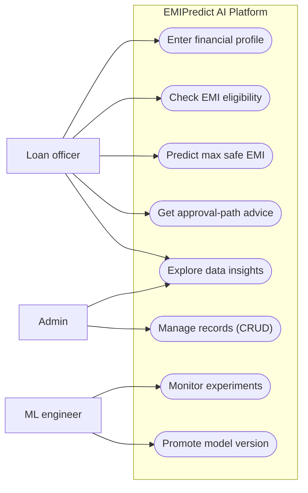
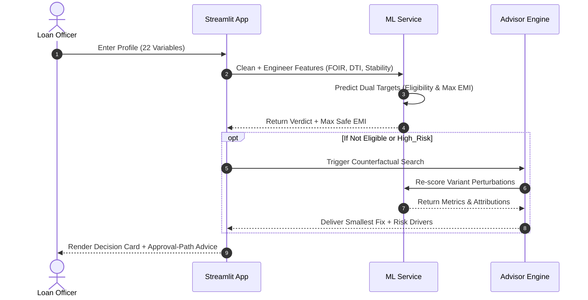
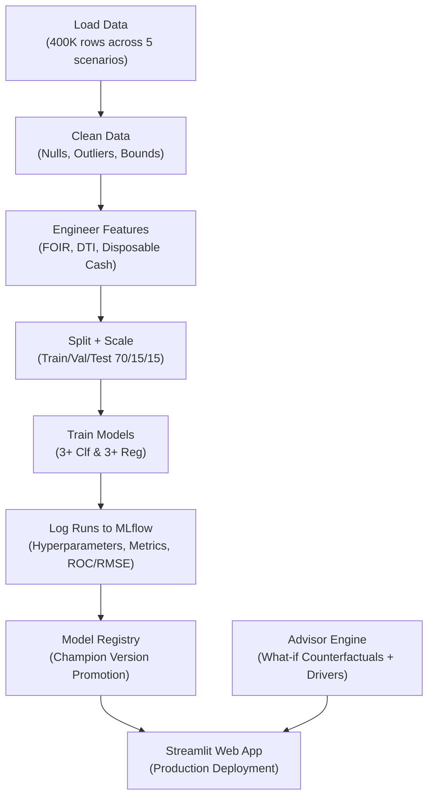

# System Architecture & Technical Specifications

## 1. System Overview
**EMIPredict AI** is an enterprise-grade financial risk assessment platform designed to automate loan underwriting, predict borrowers' maximum safe EMI, and deliver actionable counterfactual advice for subprime or borderline applicants.

---

## 2. Platform Use Case Architecture (Image 1)

---

## 3. End-to-End Underwriting Sequence Diagram (Image 2)

---

## 4. Machine Learning & MLOps Lifecycle Architecture (Image 3)

---

## 5. Domain Mathematical Formulations

### 5.1 Living Obligations & Disposable Income
$$\text{Total Expenses} = \text{Rent} + \text{School} + \text{College} + \text{Travel} + \text{Utilities} + \text{Misc}$$
$$\text{Disposable Income} = \text{Monthly Salary} - \text{Total Expenses} - \text{Current EMI}$$

### 5.2 Fixed Obligation to Income Ratio (FOIR)
$$\text{FOIR} = \frac{\text{Current EMI} + \text{Proposed Loan EMI} + \text{Rent}}{\text{Monthly Salary}}$$
*Prudent Banking Limit: $\le 50.0\%$ (Tiered up to $60.0\%$ for credit scores $> 750$).*

### 5.3 Algorithmic Safe Monthly EMI
$$\text{Max Safe EMI} = \min\left( \text{Monthly Salary} \times \text{FOIR}_{\text{cap}} - \text{Current EMI}, \; \text{Disposable Income} \times 0.75 \right)$$
Enforced between ₹500 and ₹50,000 INR.

### 5.4 Loan Amortization Formula
$$\text{EMI} = P \times \frac{r(1+r)^n}{(1+r)^n - 1}$$
Where $P$ is principal requested, $r$ is monthly scenario interest rate, and $n$ is repayment tenure in months.
