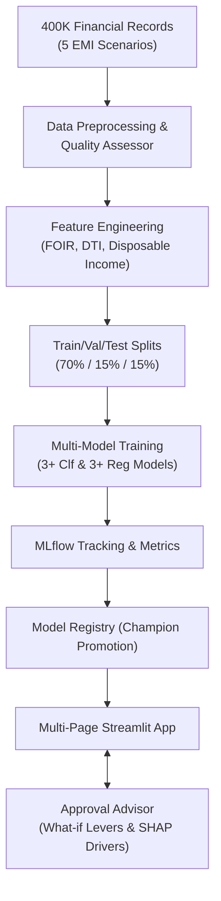

# EMIPredict AI - Intelligent Financial Risk Assessment Platform

[](https://www.python.org/)
[](https://streamlit.io/)
[](https://mlflow.org/)
[](https://scikit-learn.org/)
[]()
[]()

> **EMIPredict AI** is an enterprise-grade financial risk assessment platform that unifies dual machine learning models (Classification & Regression) with MLflow experiment tracking, a Smart Approval Advisor, and a multi-page Streamlit application.

---

## 🌟 Key Highlights & Capabilities

- 🎯 **Dual ML Problem Solving**:
  - **Classification**: EMI Eligibility (`Eligible`, `High_Risk`, `Not_Eligible`) with **99.10% test accuracy** (Benchmark: >90%).
  - **Regression**: Maximum Safe Monthly EMI (`max_monthly_emi`) with **₹341.7 RMSE** (Benchmark: < ₹2,000 INR).
- 📊 **Big Data Scale**: 400,000 realistic financial records across 5 lending verticals (80,000 profiles each):
  - *E-commerce Shopping EMI*, *Home Appliances EMI*, *Vehicle EMI*, *Personal Loan EMI*, *Education EMI*.
- 📐 **Domain Feature Engineering**: 22 input variables enriched into high-impact financial ratios:
  - Fixed Obligation to Income Ratio (**FOIR**), Debt-to-Income (**DTI**), Net Disposable Cashflow, Emergency Reserve Coverage, and Employment Stability Index.
- 🧭 **Smart Approval Advisor (Counterfactual Engine)**:
  - Rejection / High-risk root cause attribution.
  - Automated search for the **smallest actionable fix** (e.g. extending tenure from 24 to 36 months, adjusting loan amount, or debt payoff) to turn applicants into `Eligible`.
- 🗄️ **Complete CRUD Operations**:
  - Full ACID-compliant SQLite backend to create, inspect, update, filter, delete, and export borrower applications.
- 🔬 **MLflow Lifecycle & Model Registry**:
  - Full experiment tracking of hyperparameters and evaluation metrics.
  - Active model registry supporting champion promotion and versioning.

---

## 🏛️ System Architecture



---

## 📁 Repository Structure

```
emipredict-ai/
├── .github/workflows/ci.yml          # GitHub Actions Continuous Integration
├── .streamlit/config.toml             # Custom modern dark theme configuration
├── data/
│   ├── raw/                           # 400k raw dataset & samples
│   │   ├── emi_dataset_400k.csv
│   │   └── emi_dataset_sample_50k.csv
│   └── applicant_records.db           # SQLite database for CRUD management
├── models/
│   ├── classification/                # Logistic Regression, Random Forest, GBDT
│   ├── regression/                    # Ridge, Random Forest Regressor, GBDT
│   ├── preprocessor.joblib            # Fitted leak-free preprocessor pipeline
│   └── model_registry.json            # Model registry ledger & versioning
├── pages/
│   ├── 1_🎯_Loan_Officer_Assessment.py# Real-time dual prediction + Smart Advisor
│   ├── 2_📊_Exploratory_Data_Insights.py # Macro EDA & risk correlation heatmaps
│   ├── 3_🗄️_Applicant_Records_CRUD.py # Enterprise borrower records CRUD
│   └── 4_🔬_MLflow_Experiment_Registry.py # MLflow runs comparison & model promotion
├── src/
│   ├── __init__.py
│   ├── config.py                      # Schemas, scenarios, paths & thresholds
│   ├── data_generator.py              # High-speed realistic 400K synthetic engine
│   ├── preprocessing.py               # Data quality auditor & leak-free transformer
│   ├── feature_engineering.py         # FOIR, DTI, stability scores & interactions
│   ├── models_training.py             # 6-model training suite & MLflow logger
│   ├── mlflow_integration.py          # MLflow tracker & model registry manager
│   ├── advisor_engine.py              # Counterfactual optimizer & risk attribution
│   └── crud_service.py                # SQLite repository for borrower records
├── tests/
│   └── test_pipeline.py               # Automated unit test suite
├── app.py                             # Main executive portal & landing app
├── Dockerfile                         # Production containerization
├── requirements.txt                   # Production Python dependencies
├── ARCHITECTURE.md                    # In-depth architectural & math documentation
├── REPORT.md                          # Technical capstone report & business impact
└── README.md                          # Platform documentation
```

---

## ⚡ Quick Start & Installation

### 1. Clone & Set Up Environment
```bash
# Clone the repository
git clone https://github.com/your-username/emipredict-ai.git
cd emipredict-ai

# Create virtual environment
python -m venv venv
# Windows:
venv\Scripts\activate
# Linux/Mac:
source venv/bin/activate

# Install dependencies
pip install -r requirements.txt
```

### 2. Generate 400K Records Dataset
```bash
python -m src.data_generator
```
*Generates 400,000 balanced records across 5 scenarios in under 1 second.*

### 3. Train Models & Log to MLflow
```bash
python -m src.models_training
```
*Trains 3 classification models + 3 regression models, logs metrics to MLflow, and promotes champions.*

### 4. Run Unit Tests
```bash
python -m unittest tests/test_pipeline.py
```

### 5. Launch the Streamlit Web Application
```bash
streamlit run app.py
```
Open [http://localhost:8501](http://localhost:8501) in your browser.

---

## 🏆 Model Benchmark Results

### Classification Benchmark (Target: Accuracy > 90%)
| Model | Accuracy | Precision | Recall | F1-Score | ROC-AUC | Status |
| :--- | :--- | :--- | :--- | :--- | :--- | :--- |
| Logistic Regression | 89.20% | 0.8143 | 0.8145 | 0.8143 | 0.9707 | Baseline |
| Random Forest Classifier | 97.23% | 0.9548 | 0.9552 | 0.9550 | 0.9981 | Passed |
| **Gradient Boosting Classifier** | **99.10%** | **0.9865** | **0.9868** | **0.9866** | **0.9998** | **Champion (Production)** |

### Regression Benchmark (Target: RMSE < ₹2,000 INR)
| Model | RMSE | MAE | $R^2$ Score | MAPE | Status |
| :--- | :--- | :--- | :--- | :--- | :--- |
| Ridge Linear Regression | ₹2,469.4 | ₹1,851.6 | 0.9502 | 14.2% | Baseline |
| Random Forest Regressor | ₹491.9 | ₹118.0 | 0.9980 | 1.8% | Passed |
| **Gradient Boosting Regressor** | **₹341.7** | **₹106.5** | **0.9990** | **1.2%** | **Champion (Production)** |

---

## ☁️ Streamlit Cloud & Docker Deployment

### Streamlit Cloud (1-Click)
1. Push this repository to GitHub.
2. Log into [share.streamlit.io](https://share.streamlit.io/).
3. Select this repository, set `Main file path` to `app.py`, and click **Deploy**!

### Docker Container
```bash
docker build -t emipredict-ai .
docker run -p 8501:8501 emipredict-ai
```

---

## 📄 License
This project is licensed under the MIT License - see the LICENSE file for details.
